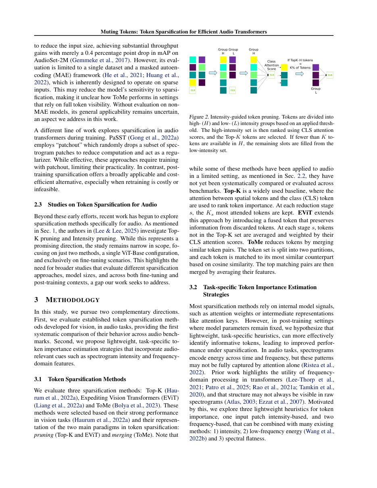
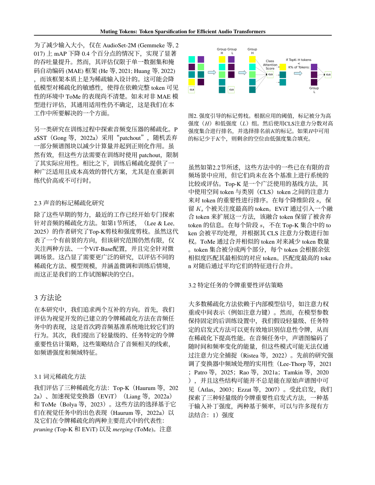
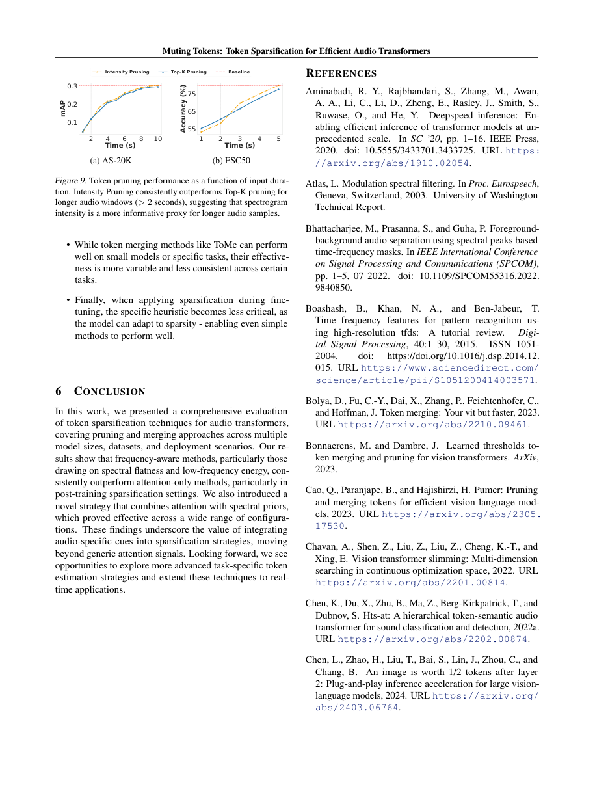
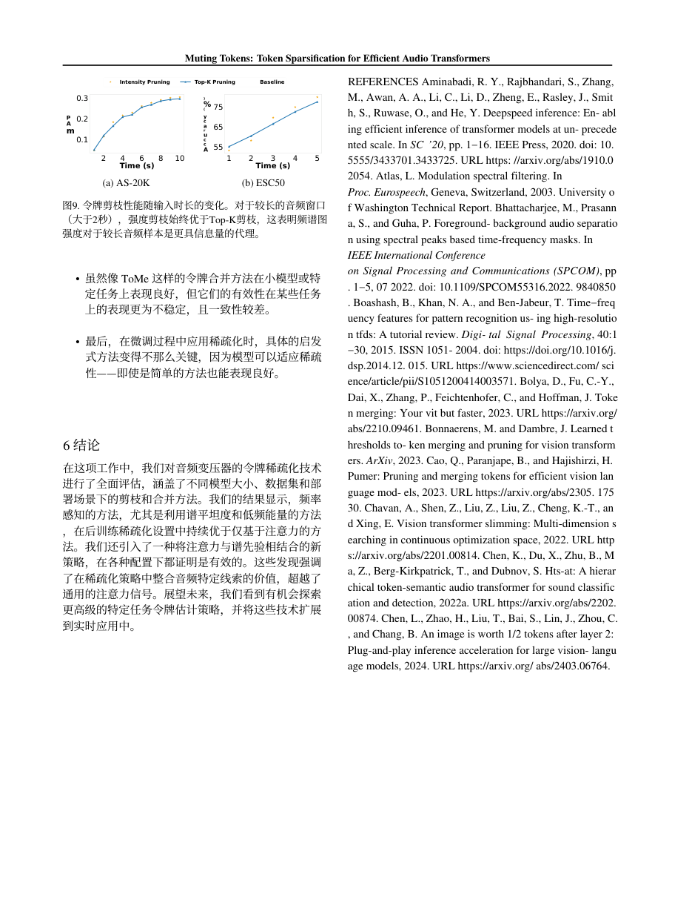

# Paper Translate

整本学术 PDF 论文 → 中文，**保留原排版、公式与图片位置**，参考文献默认保持英文原文。

底座是 [PDFMathTranslate](https://github.com/Byaidu/PDFMathTranslate)（pdf2zh 1.9.11，EMNLP 2025），外面封了四层：

- **translate.py** — 单篇/批量翻译、断点续跑；一次产出**纯中文版**和**双语对照版**两份
- **术语表** — `config/术语表.csv`（term,译法,说明），预置约 100 条科研常用词（VLN / VLA / NLOS / CRLB / SPL 等），翻译前渲染进 prompt，加一行即生效
- **参考文献保持原文** — 自动定位 REFERENCES 起始页：正文页正常翻、混合页按条目判定跳过、其后页整页保持英文（`--translate-refs` 可关）
- **check.py 版面体检** — 自动核对页数、每页图片数量与位置（1pt 容差）、矢量元素差异、疑似漏翻页

## 安装

```bash
git clone https://github.com/williamtymhuabian/paper-translate.git
cd paper-translate
python -m venv .venv
.venv/Scripts/pip install -r requirements.txt -i https://mirrors.aliyun.com/pypi/simple/
cp config/env.example.json config/env.json   # Linux/macOS 用 cp
```

需要 Python 3.10/3.11。四个依赖的版本钉死的原因见下方[已知坑](#已知坑)。

## 使用

```bash
# 翻译一篇（产出 output/xxx-mono.pdf 与 xxx-dual.pdf）
.venv/Scripts/python translate.py 论文.pdf

# 批量翻译一个目录 / 断点续跑
.venv/Scripts/python translate.py 目录/ --resume

# 改过术语表后重翻（必须绕过缓存）
.venv/Scripts/python translate.py 论文.pdf --fresh

# 连参考文献一起翻译
.venv/Scripts/python translate.py 论文.pdf --translate-refs

# 翻完体检
.venv/Scripts/python check.py 论文.pdf
```

## 翻译引擎

在 `config/env.json` 的 `engine` 字段切换：

| engine | 说明 |
|---|---|
| `bing` | 免费，开箱即用；术语直译，质量一般 |
| `openai` | 任何 OpenAI 兼容网关（填 `OPENAI_BASE_URL` / `OPENAI_API_KEY` / `OPENAI_MODEL`），质量最好 |

其他 pdf2zh 支持的引擎（google/deepl 等）同样可通过 env.json 切换。换 key 后可跑 `test_api.py` 验证连通性。

## 示例

`example/` 里放了一篇完整实测：MutingTokens（arXiv 2610.31235，12 页，Bing 引擎，78 秒）。

| 文件 | 内容 |
|---|---|
| `MutingTokens-original.pdf` | 英文原文 |
| `MutingTokens-mono.pdf` | 纯中文版（版面与原文一致） |
| `MutingTokens-dual.pdf` | 双语对照版（原文页/译文页交替） |

**正文页效果**（第 3 页：双栏、图 2、内联公式全部原位）：

| 原文 | 译文 |
|---|---|
|  |  |

**参考文献保持原文**（第 9 页：左栏结论正常翻译，右栏 REFERENCES 及条目保持英文）：

| 原文 | 译文 |
|---|---|
|  |  |

体检结果：页数一致（12/12），图片数量与位置 0 异常，矢量元素 0 差异，疑似漏翻 0 页。

## 已知坑

| 包 | 钉死版本 | 原因 |
|---|---|---|
| pdf2zh | 1.9.11 | 2.x 接口完全不同 |
| tencentcloud-sdk-python-tmt | 3.0.1478 | 3.1.x 删掉 `TextTranslateRequest` |
| onnxruntime | 1.19.2 | 1.31 在部分机器（核显）导入即段错误 |
| bitstring | 4.3.0 | 5.0 删掉 `BitStream` |

pdf2zh 1.x 行为备忘：

- `--pages` 只控制"翻译哪些页"，输出仍包含全部页；分片拼接要按页码取页。
- 补丁必须打在 `BaseTranslator.translate`（统一入口），打在 `do_translate` 会被引擎子类覆盖。
- 聚合文本块可能超 2000 字符且无换行，参考文献判定用"姓, 名缩写"模式全局计数（`refs_skip.py`）。
- 翻译多线程进行，不要按文本顺序判断是否进入参考文献区（会误杀双栏页正文）。
- HuggingFace 模型下载默认走 hf-mirror.com。

## 实测

MutingTokens（arXiv 2610.31235，12 页，Bing 引擎）：78 秒翻完，体检 0 异常；第 9 页左栏结论中文、右栏 REFERENCES 英文原样，第 10–12 页整页原文；人工抽查双栏结构、图、内联公式全部原位。

## License

MIT
